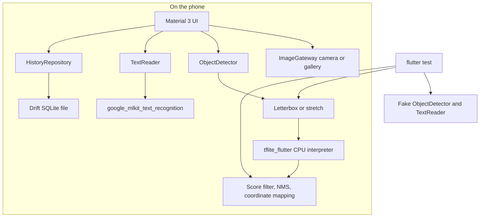

# Stillframe

On-device object detection and text recognition for Android and iOS. Photos are not uploaded. Detection runs a TensorFlow Lite graph through `tflite_flutter`. Latin text recognition uses `google_mlkit_text_recognition`. Scans are stored on the phone with Drift.

This is a portfolio demo for Arpan Bom. It is not a benchmarked product, and it does not ship model weights.



`ObjectDetector` and `TextReader` are the boundaries tests use. The widget tests never open TensorFlow Lite, ML Kit, or a camera.

## Run it

Install Flutter 3.47 or the current stable channel, then:

```bash
flutter pub get
flutter run
```

The app is Stillframe. Android `minSdk` is 26. iOS deployment target is 15.5, which ML Kit requires.

Until you add a detection model, object detection explains how to install one. Text recognition does not need that file. ML Kit's Latin model is bundled by the plugin and runs on device. There is no cloud vision API in this app.

History is a Drift database in the application support directory. Stable Hive 2 does not support Dart 3, so this project uses Drift.

## Add a detection model

Do not commit the `.tflite` file. `*.tflite` is gitignored. The weights below are TensorFlow models under the [Apache License 2.0](https://www.apache.org/licenses/LICENSE-2.0). The TensorFlow models license file is [github.com/tensorflow/models/blob/master/LICENSE](https://github.com/tensorflow/models/blob/master/LICENSE). Read that license before you redistribute a model. This repository does not redistribute the weights.

The bundled `assets/models/labelmap_ssd_mobilenet_v1.txt` is `labelmap.txt` from the SSD archive below. The line index is the class id, including the `???` placeholder rows. `classIndexBase` in the config is `0` for that file.

### SSD MobileNet v1, quantized, 300×300

```bash
curl -L -o /tmp/coco_ssd_mobilenet.zip \
  https://storage.googleapis.com/download.tensorflow.org/models/tflite/coco_ssd_mobilenet_v1_1.0_quant_2018_06_29.zip
unzip -p /tmp/coco_ssd_mobilenet.zip detect.tflite > assets/models/detect.tflite
```

`assets/models/model_config.json` already matches this checkpoint: 300×300, normalized `yxyx` boxes, letterbox on, NMS on.

### EfficientDet-Lite0, 320×320

```bash
curl -L -o assets/models/detect.tflite \
  https://storage.googleapis.com/download.tensorflow.org/models/tflite/task_library/object_detection/android/lite-model_efficientdet_lite0_detection_metadata_1.tflite
```

Set `inputWidth` and `inputHeight` to 320. If the class names are shifted, change `classIndexBase`. The interpreter uses the input tensor's height and width when they differ from the config.

### Load the file

Either:

1. Put `assets/models/detect.tflite` in the project, add it under `flutter: assets:` in `pubspec.yaml`, and rebuild. The asset line is commented out so a checkout without the file still analyzes and tests.
2. Or copy it to the application support directory `models/detect.tflite`. That copy wins over the asset. On a debug Android build:

```bash
adb push detect.tflite /data/local/tmp/detect.tflite
adb shell run-as dev.arpanbom.stillframe.flutter_on_device_ml mkdir -p files/models
adb shell run-as dev.arpanbom.stillframe.flutter_on_device_ml cp /data/local/tmp/detect.tflite files/models/detect.tflite
```

The detector expects a float32 post-processed graph: boxes, classes, scores, and usually a count. Letterboxing preserves aspect ratio and maps boxes back onto the photo. NMS runs in Dart as well. A graph that does not match fails with an error. The CPU interpreter is used. GPU and NNAPI delegates are off.

## Latency

These cells are placeholders. This demo does not include device measurements. Do not treat them as results.

| Stage | Latency |
| --- | --- |
| Letterbox | placeholder |
| Interpreter invoke | placeholder |
| NMS and coordinate mapping | placeholder |
| End to end on a phone | placeholder |

## Test

```bash
flutter analyze
flutter test
```

Unit tests cover letterboxing, non-maximum suppression, mapping model boxes back to the photo, and mapping those boxes onto the overlay. Widget tests drive the camera/gallery flow, the overlay, text recognition, history, and the model-missing state with fakes. No emulator, simulator, or GPU run is required.

CI (`.github/workflows/ci.yml`) runs `flutter analyze` and `flutter test` on the stable channel.

## Portfolio demo

Stillframe is a portfolio demo. It shows an on-device pipeline with a testable boundary around inference. It is not a claim about accuracy or speed. Latency in the app and in this file is marked `placeholder` on purpose.
